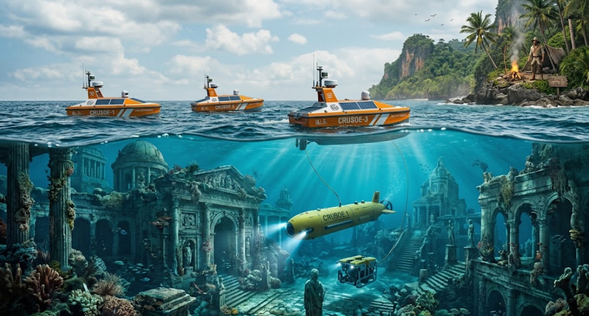

<div align="center">



# ROBOTson Crusoe: Let's Explore the Lost City

**BEST Fall Course 2026 · Marine Robotics · ENSTA Brest**


*Notes, code and experiments from a one-week intensive course on autonomous marine robotics, from theory to field trials at Lake Guerlédan.*

</div>

---

## Table of Contents

- [About](#about)
- [Course Information](#course-information)
- [Curriculum](#curriculum)
- [Team Project: DD-Boat 11](#team-project-dd-boat-11)
- [Repository Structure](#repository-structure)
- [Getting Started](#getting-started)
- [Progress](#progress)
- [References](#references)
- [Acknowledgments](#acknowledgments)
- [Disclaimer](#disclaimer)
- [Author](#author)

---

## About

This repository documents my work during **ROBOTson Crusoe**, a BEST (Board of European Students of Technology) course hosted at **ENSTA Brest**, France.

The course covers three key areas of marine robotics:

- **Autonomous robotic missions**: planning and executing missions without human intervention
- **Command and control**: modelling, heading control and guaranteed methods
- **Sensors**: acoustic, magnetic and optical perception in the marine environment

The course moves **from theory to practice on real systems**. Lectures and Python coding sessions are followed by a field lab and the piloting of real marine robots at **Lake Guerlédan**. The week ends with a **final lake challenge**.

### Learning objectives

By the end of the course, I aim to be able to:

1. Model a surface vessel and design a heading controller for it
2. Apply **interval analysis** to guaranteed localization
3. Reason about the **reachable sets** of a dynamical system
4. Train and evaluate a **reinforcement learning** agent for boat control
5. Build and use a basic **digital twin** of a marine robot
6. Remotely operate a marine craft in real conditions

---

## Course Information

| | |
|---|---|
| **Title** | ROBOTson Crusoe: Let's Explore the Lost City |
| **Organizers** | BEST, with ENSTA Brest |
| **Location** | ENSTA Brest and Lake Guerlédan, Brittany, France |
| **Period** | Fall 2026 (one week) |
| **Fields** | Computer Science · Automatic Control · Systems Engineering · Mechatronics |
| **Format** | Lectures · hands-on Python · robot piloting · field lab · final lake challenge |
| **Prerequisites** | Basic Python |
| **Assessment** | Project |
| **Credits** | 1 ECTS |

---

## Curriculum

| # | Module | Instructor | Folder |
|---|---|---|---|
| 1 | Introduction to Mobile Marine Robotics | Luc Jaulin | n/a |
| 2 | Autonomous Boats | Luc Jaulin | [`Day1`](Day1) |
| 3 | Heading Control of the Virtual DD-Boat | Antoine Morvan | [`Day1`](Day1) |
| 4 | Interval Analysis for Localization | Luc Jaulin | [`Day2`](Day2) |
| 5 | Reachability | Maël Godard | [`Day2`](Day2) |
| 6 | Robot Showcase | AICE | [`Day2`](Day2) |
| 7 | Reinforcement Learning for Autonomous Boats (Part 1) | Romain Bornier | [`Day3`](Day3) |
| 8 | Reinforcement Learning for Autonomous Boats (Part 2) | Romain Bornier | [`Day3`](Day3) |
| 9 | Digital Twins: Fundamentals | Antoine Morvan | [`Day4`](Day4) |
| 10 | Oceanic Robotics | Jean-Philippe Brunet | Coming soon |
| 11 | Digital Twins: Practice | Antoine Morvan | [`Day4`](Day4) |
| 12 | **The Race**: Final Challenge | Luc Jaulin | [`Day4/NavySeals`](Day4/NavySeals) |

<details>
<summary><b>Key questions addressed by each module</b></summary>

<br>

**Marine robotics and autonomous boats**
- What makes the marine environment harder for a robot than a ground environment?
- How is a surface vessel described as a state-space system **ẋ = f(x, u)**?
- What is the difference between point tracking and line following?

**Heading control (DD-Boat)**
- How is a desired heading turned into differential thrust commands?
- How should an angular error be computed so that it stays consistent across ±π?

**Interval analysis and reachability**
- What does it mean for a localization method to be *guaranteed*?
- How do contractors and bisection (e.g. SIVIA) characterize a solution set?
- Why is over-approximation the right choice for proving safety?

**Reinforcement learning**
- How is boat control formulated as a Markov decision process?
- How does the reward design shape, and sometimes distort, the learned behaviour?
- How can the sim-to-real gap be reduced?

**Digital twins and oceanic robotics**
- What separates a digital twin from a plain simulation?
- Why is energy the central constraint of long-duration ocean missions?
- How do submerged robots localize and communicate?

</details>

---

## Team Project: DD-Boat 11

On **Day 3 (Wednesday)** the teams were formed and the project began. I joined team **NavySeals**, in charge of **DD-Boat 11**: a differential-drive surface vessel (two brushless thrusters, no rudder) running on a Raspberry Pi 3 with an Arduino MEGA, a 9-DOF IMU and a GPS receiver. The goal is to make it navigate autonomously on Lake Guerlédan and compete in the **Friday regatta** (5 minutes, +1 point per gate crossed in the right direction, −1 otherwise).

**Done on Day 3**

- Network and SSH setup on the boat, hardware smoke test (IMU, GPS, Arduino)
- Compass calibration (hard- and soft-iron correction, rewritten in pure NumPy since `scipy` is not on the boat)
- Motor test and GPS georeferencing (UTM zone 30N, KML export for Google Earth)
- All checks of the `best_ddboat` handout passed
- First controllers: heading hold, GPS waypoints, return-to-home ("no-kayaking"), keyboard teleoperation and the regatta state machine

**Done on Day 4**

- **Ground station GUI** on the laptop: one click switches between keyboard RC and autonomous mode, with a STOP button, live instruments (compass, motor bars, score) and the boat's terminal
- Regatta controller rewritten: gates read from a JSON file, real ±1 scoring of gate segment crossings, safety checks before the start and a GPS dropout watchdog
- Latched keyboard teleop and a more robust waypoint follower
- Digital twin exercises (straight line, turn direction, pivot, square)

Details: [`Day4/NavySeals/README.md`](Day4/NavySeals/README.md).

The boat runs **Python 3.5.3**, so no f-strings. Full details: [`REGATTA_MISSION_PLAN.md`](Day4/NavySeals/REGATTA_MISSION_PLAN.md) (competition strategy), [`COMPASS_CALIBRATION_REPORT.md`](Day3/NavySeals/COMPASS_CALIBRATION_REPORT.md).

---

## Repository Structure

```
.
├── README.md
├── assets/
│   └── ImgBest26.png                   # README banner
├── Day1/                               # Monday: autonomous boats & DD-Boat heading control
│   ├── README.md                       # write-up of the exercise
│   ├── ddboatlib.py                    # plotting helpers (init_figure, draw_ddboat, sawtooth…)
│   ├── simulator.py                    # DD-Boat model + heading controller, waypoint following
│   └── client_pour_virtual_regatta.py  # UDP client driving the boat in the Unity virtual regatta
├── Day2/                               # Tuesday: interval analysis for localization
│   ├── README.md                       # detailed write-up of the exercise
│   ├── myinterval.py                   # minimal interval arithmetic
│   ├── mycontractor.py                 # elementary contractors
│   └── loc_start.py                    # localization of a group of 8 robots
├── Day3/NavySeals/                     # Wednesday: team project on the real DD-Boat 11
│   ├── README.md                       # write-up of the project
│   ├── REGATTA_MISSION_PLAN.md         # strategy for the Friday regatta
│   ├── stop.py                         # emergency stop (both thrusters to 0)
│   ├── boat11_smoke_test.py            # IMU / GPS / Arduino check
│   ├── motor_test.py                   # 2 s in-place turn
│   ├── calib.py                        # compass calibration + live heading
│   ├── gps.py                          # NMEA parsing, UTM projection, KML log
│   ├── battery*.py                     # battery voltage and state of charge
│   ├── heading_hold.py                 # sawtooth proportional heading control
│   ├── waypoint_mission.py             # GPS waypoint navigation
│   ├── control.py                      # boomerang and GPS return-to-home
│   ├── rc_teleop.py                    # keyboard teleoperation over SSH
│   └── regatta_loop.py                 # gate A ↔ B regatta controller
└── Day4/                               # Thursday: digital twins
    ├── README.md                       # write-up of the exercise
    ├── sim_digital_twin.py             # kinematic DD-Boat model, open-loop thrust tests
    ├── boat_observer.py                # UDP link to the boat + state observer on its measurements
    └── NavySeals/                      # team project: ground station and regatta (Day 3 scripts, updated)
        ├── README.md                   # what changed since Day 3
        ├── boat_gui.py                 # laptop GUI: RC / autonomous switch, STOP, live instruments
        ├── regatta_loop.py             # regatta controller, ±1 scoring of gate crossings
        ├── regatta_gates.example.json  # gate file template
        ├── rc_teleop.py                # latched keyboard teleoperation
        ├── waypoint_mission.py         # robust GPS waypoint navigation
        ├── simu_page13.py              # digital twin exercises
        └── …                           # other boat scripts, same as Day 3
```

Folders for the following days will be added as the week goes on.

---

## Getting Started

### Requirements

- Python 3.x
- NumPy, Matplotlib
- [`roblib`](https://pypi.org/project/roblib/) (course plotting helpers, used in Day 2)

### Installation

```bash
git clone https://github.com/SamutourR115/marine-robotics-ensta-brest.git
cd marine-robotics-ensta-brest
python -m venv .venv
source .venv/bin/activate        # Windows: .venv\Scripts\activate
pip install numpy matplotlib roblib
```

### Usage

Scripts import their neighbours by name, so run them from inside their folder:

```bash
cd Day1 && python simulator.py     # DD-Boat waypoint following
cd Day2 && python loc_start.py     # interval localization
cd Day4 && python sim_digital_twin.py   # digital twin simulation
cd Day4/NavySeals && python boat_gui.py # ground station GUI (needs the boat on the network)
```

The `Day3/NavySeals` and `Day4/NavySeals` scripts run **on the boat** over SSH, not on a laptop: they need the course drivers (`arduino_driver_v2`, `gps_driver_v2`, `imu9_driver_v2`). The exception is `boat_gui.py`, which runs on the laptop and starts them for you. Each script's docstring gives its usage.

`client_pour_virtual_regatta.py` needs the course's Unity simulator on the network (set `UNITY_IP` first). Each day folder has its own README explaining the exercise: [Day1](Day1/README.md), [Day2](Day2/README.md), [Day3](Day3/NavySeals/README.md), [Day4](Day4/README.md) and [Day4/NavySeals](Day4/NavySeals/README.md).

---

## Progress

| Module | Notes | Code | Status |
|---|:---:|:---:|:---:|
| Introduction to Mobile Marine Robotics | ☐ | n/a | Pending |
| Autonomous Boats | ☐ | ☑ | In progress |
| Heading Control of the Virtual DD-Boat | ☐ | ☑ | In progress |
| Interval Analysis for Localization | ☑ | ☑ | Done |
| Reachability | ☐ | ☐ | Pending |
| Robot Showcase (AICE) | ☐ | n/a | Pending |
| Reinforcement Learning (Part 1) | ☐ | ☐ | Pending |
| Reinforcement Learning (Part 2) | ☐ | ☐ | Pending |
| Digital Twins: Fundamentals | ☐ | ☑ | In progress |
| Oceanic Robotics | ☐ | n/a | Pending |
| Digital Twins: Practice | ☐ | ☑ | In progress |
| Team Project: DD-Boat 11 (NavySeals) | ☑ | ☑ | In progress |
| The Race: Final Challenge | ☐ | ☑ | In progress |

---

## References

- L. Jaulin, *Mobile Robotics*, ISTE / Wiley.
- L. Jaulin, M. Kieffer, O. Didrit, É. Walter, *Applied Interval Analysis*, Springer, 2001.
- L. Jaulin, teaching resources: <https://www.ensta-bretagne.fr/jaulin/>
- Codac library: <https://codac.io>

---

## Acknowledgments

I thank the instructors, **Luc Jaulin**, **Antoine Morvan**, **Maël Godard**, **Romain Bornier** and **Jean-Philippe Brunet**, for their teaching, the **AICE** team for presenting their robots, and **BEST** and **ENSTA Brest** for organizing this course.

---

## Disclaimer

This repository contains my personal notes and implementations. Course materials (slides, handouts and starter code) remain the property of their respective authors and are not redistributed here. Any errors are my own.

---

## Author

**Sam**, BSc student in Computer Science (Intelligent Systems), University of Liège
[GitHub](https://github.com/SamutourR115) · [LinkedIn](https://www.linkedin.com/in/samuel-mastroscianni-395b6126b)
